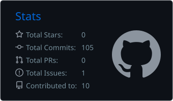
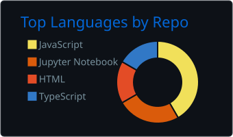

# Hi, I'm K. Jagan Mohan Reddy 👋

### Full Stack Developer | AI/ML Enthusiast

Building real-world solutions through code, problem-solving, and continuous learning.

---

### About Me

- Developing real-world full-stack applications
- Exploring Artificial Intelligence and Machine Learning
- Practicing Data Structures and Algorithms
- Interested in System Design and scalable software architecture
- Focused on continuous learning and practical problem-solving

---

### Tech Stack

**Programming Languages**

**Frontend Development**

**Backend Development**

**Databases**

**Tools and Platforms**

---

### Featured Projects

- **Event Sphere**: A club and event management platform for managing institutional clubs, event creation, and approval workflows.
- **VID – Virtual Intelligent Digital Platform**: A multi-tenant institutional management platform with modular workspaces and role-based access.
- **Autonomous Drone**: An autonomous drone project focused on navigation, flight control integration, and QR code detection.

---

### GitHub Statistics

  
  

  

---

### Connect With Me

---

  

⭐ Thanks for visiting my GitHub profile!

